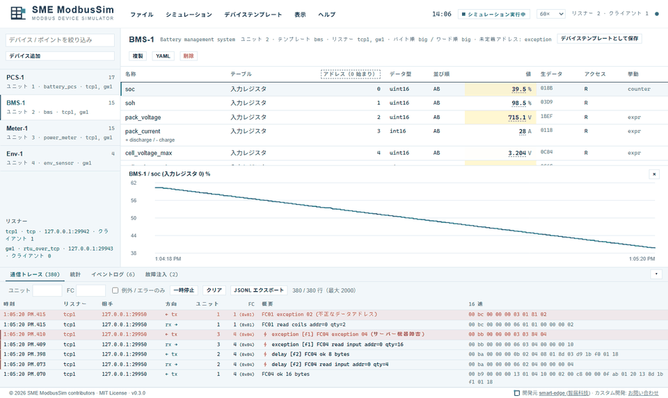
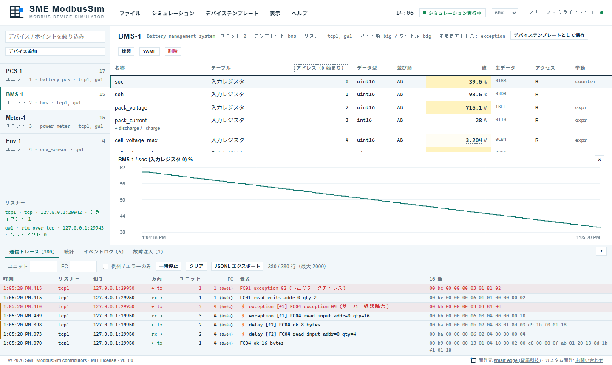
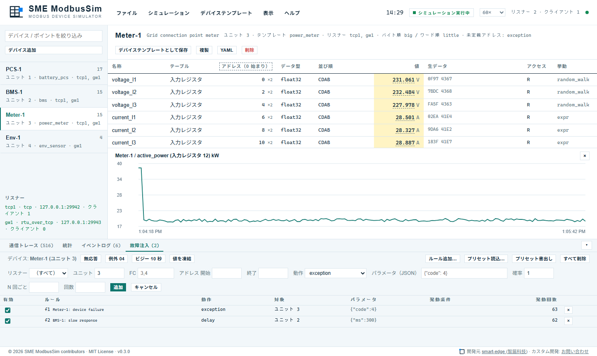
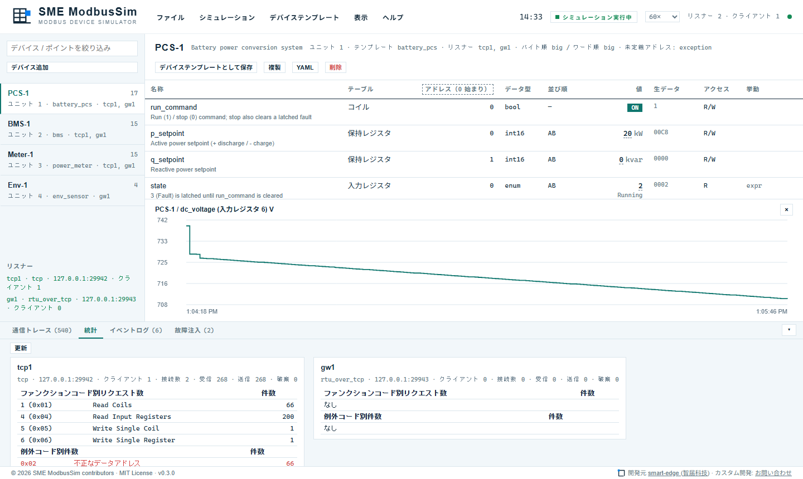
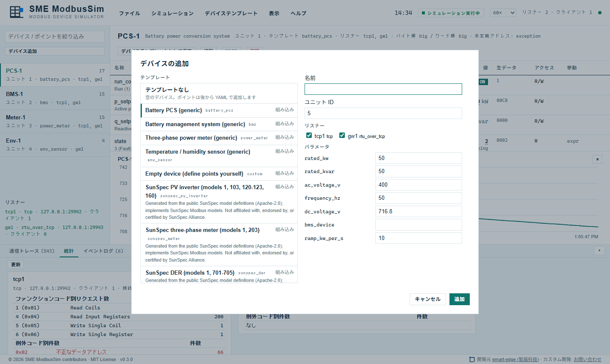
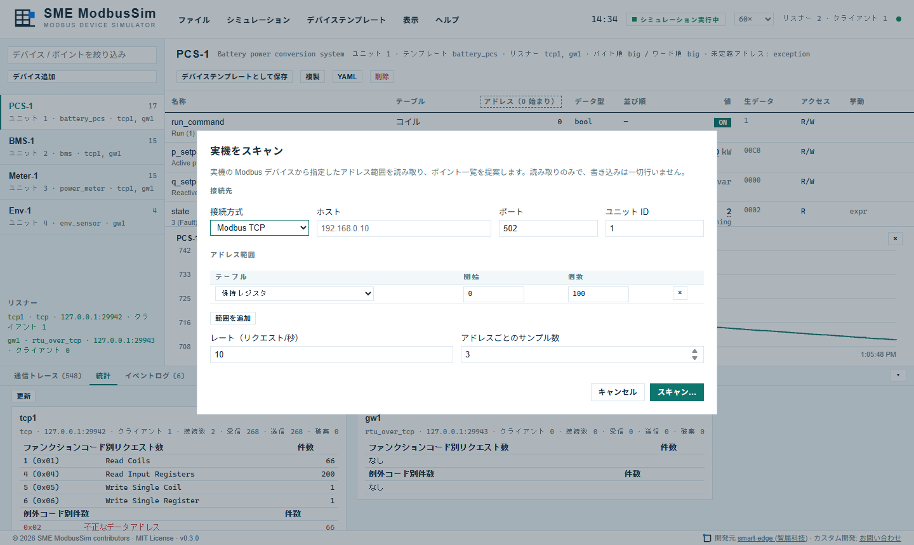

<p align="center"></p>

<h1 align="center">SME ModbusSim</h1>

<p align="center"><strong>ノート PC 1 台で、Modbus デバイスをまるごと再現。</strong><br>PCS・BMS・メータ・センサを TCP / UDP / TLS / シリアルで、ライブ Web UI 付き。</p>

<p align="center"><a href="https://smartedge-tech.com/open-source/#modbus-sim"><b>Web サイト</b></a> · <a href="https://smartedge-tech-dev.github.io/sme-modbus-sim/ja/"><b>ドキュメント</b></a> · <a href="https://github.com/smartedge-tech-dev/sme-modbus-sim/releases/latest"><b>ダウンロード</b></a></p>

<p align="center"><a href="https://github.com/smartedge-tech-dev/sme-modbus-sim/actions/workflows/ci.yml"></a> <a href="https://github.com/smartedge-tech-dev/sme-modbus-sim/releases/latest"></a> <a href="https://github.com/smartedge-tech-dev/sme-modbus-sim/blob/main/LICENSE"></a>  </p>

<p align="center"><a href="README.md">English</a> | <strong>日本語</strong> | <a href="README.zh-CN.md">简体中文</a></p>

<p align="center"></p>

ライブ Web UI 付きの、無料・オープンソース（MIT）の Modbus TCP / RTU スレーブ（サーバー）シミュレーターです。
Windows / Linux / Docker で動作します。蓄電池 PCS、BMS、電力量計、環境センサー、
あるいは YAML で記述した任意のレジスタマップを模擬し、実際の Modbus マスター（EMS、ゲートウェイ、modpoll、
pymodbus など）が読み書きする様子を、値の変化とともにブラウザで確認できます。

- **1 つのポートで複数デバイス。** 1 つのリスナーが複数のユニット ID を受け持ち、1 台のデバイスを複数のリスナーに
  接続することもできます。Modbus TCP、Modbus UDP、Modbus/TCP Security（TLS）、Modbus RTU over TCP（シリアルゲートウェイ向け）、シリアル RTU、シリアル ASCII（COM ポート / tty）を同時に利用できます。
- **独自のプロトコルコア。** ファンクションコード 01 / 02 / 03 / 04 / 05 / 06 / 0F / 10 / 16 / 17 / 2B-0E（16 進）に対応し、標準の例外
  レスポンスを返します。シリアルリスナーは診断ファンクションコード 07 / 08 / 0B / 0C / 11 にも応答します。Modbus TCP / RTU 互換のフレーミング（MBAP、CRC-16）です。
- **豊富なデータ型。** `bool`、`int16` / `uint16`、`int32` / `uint32`、`int64` / `uint64`、`float32` / `float64`、
  `string`、`enum`、レジスタ内ビットに対応し、バイトオーダー・ワードオーダー（ABCD / CDAB / BADC / DCBA）、
  スケールとオフセットを指定できます。
- **リアルな挙動。** PCS は出力指令値に向かってランプ制御で追従し、BMS は PCS の電力から SOC を積算し、
  電力量計は需要から PCS 出力を差し引いた値を示します。正弦波、ランダムウォーク、式、カウンター、パルス、
  CSV リプレイを使えます。
- **ライブ UI。** WebSocket でリアルタイム更新されるポイント一覧、ブラウザからの書き込み、ポイントごとの履歴、
  Modbus 通信ログを備えます。UI は英語・日本語・簡体字中国語です。
- **テンプレート。** 蓄電池 PCS / BMS / 電力量計 / センサーの汎用テンプレート、SunSpec PV インバーター・電力量計テンプレート、ユーザーローカルテンプレート、「デバイスをテンプレートとして保存」。
- **障害注入。** 遅延、無応答、例外、CRC 不正、切断などを UI・REST・プリセットから注入できます。
- **設定が容易。** YAML や Excel ポイント一覧を編集し、UI でデバイス管理・テンプレート閲覧を行い、設定ファイルへ保存できます。

本プロジェクト向けに書かれた asyncio ベースのプロトコルコア、FastAPI、pyserial で構成されています。フロントエンドの
ビルド工程はありません。

SME ModbusSim は無料の MIT ライセンスで、[smart-edge（智届科技）](https://smartedge-tech.com) が開発しています。
カスタム開発も承ります。[商用サポート・カスタム開発](#商用サポートカスタム開発) をご覧ください。

## スクリーンショット

<table>
  <tr>
    <td width="50%"><a href="https://raw.githubusercontent.com/smartedge-tech-dev/sme-modbus-sim/main/docs/assets/screenshots/ja/overview.png"></a><br><sub>デバイス一覧、レジスタのライブ値、SOC トレンド、例外を注入した Modbus 通信ログ</sub></td>
    <td width="50%"><a href="https://raw.githubusercontent.com/smartedge-tech-dev/sme-modbus-sim/main/docs/assets/screenshots/ja/faults.png"></a><br><sub>障害注入：有効なルールと新規ルールフォーム</sub></td>
  </tr>
  <tr>
    <td width="50%"><a href="https://raw.githubusercontent.com/smartedge-tech-dev/sme-modbus-sim/main/docs/assets/screenshots/ja/stats.png"></a><br><sub>リスナー別の統計とレジスタのトレンド</sub></td>
    <td width="50%"><a href="https://raw.githubusercontent.com/smartedge-tech-dev/sme-modbus-sim/main/docs/assets/screenshots/ja/add-device.png"></a><br><sub>デバイスの追加：組み込みテンプレート</sub></td>
  </tr>
  <tr>
    <td width="50%"><a href="https://raw.githubusercontent.com/smartedge-tech-dev/sme-modbus-sim/main/docs/assets/screenshots/ja/scan.png"></a><br><sub>実機のスキャン（読み取り専用）</sub></td>
  </tr>
</table>

## クイックスタート

### Windows exe

[Releases](https://github.com/smartedge-tech-dev/sme-modbus-sim/releases/latest) から `sme-modbus-sim-<version>-windows.exe`
をダウンロードして実行します。ブラウザで http://127.0.0.1:8081/ が開きます。

### Docker

```bash
docker run --rm -p 8081:8081 -p 5020:5020 -p 5021:5021 ghcr.io/smartedge-tech-dev/sme-modbus-sim
```

イメージは `linux/amd64`、`linux/arm64`、`linux/arm/v7` 向けに公開されます。オフライン用アーカイブ
（`docker load -i`）は各リリースに添付されます。ローカル時刻を使うには `-e TZ=Asia/Tokyo` を指定します（既定は UTC）。
独自の設定を使う場合: `-v ./my.yaml:/app/configs/my.yaml ... -c configs/my.yaml`。

### シリアル RTU と RTU over TCP

シリアル RTU は既定で 19200 baud、8E1 です（`type: rtu`、`port: COM5` または `/dev/ttyUSB0`）。RTU over TCP は RTU フレームを TCP ポートで提供し、シリアルゲートウェイや RTU over TCP モードのマスター向けです。シリアル ASCII（`type: ascii`）は既定で 19200 baud、7E1 で、1 s 文字が届かなければ未完のフレームを破棄します（`char_timeout`）。

```yaml
listeners:
  - {id: com1, type: rtu, port: COM5, baudrate: 19200, parity: E}   # serial RTU, 8E1
  - {id: gw1, type: rtu_over_tcp, host: 0.0.0.0, port: 5021}        # RTU over TCP
```

Docker ではシリアルアダプターを `--device` でコンテナーに渡します（Linux ホスト。コンテナーは root 以外で動作するため、デバイスのグループを追加します）:

```bash
docker run --rm --device /dev/ttyUSB0 --group-add dialout -p 8081:8081 \
  -v ./serial.yaml:/app/configs/serial.yaml ghcr.io/smartedge-tech-dev/sme-modbus-sim \
  python -m sme_modbus_sim run -c configs/serial.yaml --host 0.0.0.0 --no-browser
```

マスター側: `modpoll -m rtu -b 19200 -d 8 -p even -a 1 -0 -r 0 -c 4 -t 4 COM6`（シリアル接続の相手側）、RTU over TCP は `modpoll -m enc -p 5021 -a 4 -0 -r 0 -c 2 -t 3 127.0.0.1`。

1 台の Windows PC で試す場合: Windows には仮想 COM ポートのペアが標準で用意されていません。選択肢: [SerialLoom](https://github.com/RahulP5/SerialLoom)（無料、MIT。Microsoft 署名済みの usbip-win2 ホストコントローラーを使い、COM ポートは Windows 標準の usbser ドライバーが作ります）、署名済みの市販仮想シリアルポートドライバー、USB-RS485 アダプター 2 本の相互配線（A-A、B-B）。Windows 標準の usbser ドライバーは最初のバイトが届く前からバイト間タイムアウト（`ReadIntervalTimeout`）を数え始めるため、pyserial の `inter_byte_timeout` を設定するマスター（modbus_tk は既定で設定）は、応答がシステムタイマー約 1 周期（約 16 ms）より遅れると 0 バイトを読みます。SerialLoom で試験するときはマスター側で `None` にしてください（[SerialLoom#16](https://github.com/RahulP5/SerialLoom/issues/16)、[上流の既知の制限](https://github.com/RahulP5/SerialLoom/blob/main/docs/USB_PORTS.md#limitations)）。SerialLoom 0.4.0 以降、一方の DTR は相手側の DSR と DCD として伝わります（[SerialLoom#17](https://github.com/RahulP5/SerialLoom/issues/17)）。RTS は伝わらず（CTS は常にオン）、BREAK も伝わりません。仮想ペアは RTS / DTR を伝えないことがあり、ボーレートどおりの速度にもなりません。com0com 3.0 の 64 ビットドライバーは正式署名されておらず、セキュアブート有効時には読み込まれません。ドライバーなしで RTU フレームを試すなら `rtu_over_tcp` リスナーを使えます。Linux、macOS、WSL2 では、`rtu` リスナーに `port: pty`（必要なら `link: /tmp/ttyV0` も）を指定すると、ModbusSim 自身が仮想ペアを作成します（ドライバ不要）。`socat -d -d pty,raw,echo=0 pty,raw,echo=0` も使えます。

### ソースから実行 / pip

```bash
python -m venv .venv
.venv/bin/pip install -r requirements.txt        # Windows: .venv\Scripts\pip
.venv/bin/python -m sme_modbus_sim run -c configs/demo-site.yaml
```

http://127.0.0.1:8081/ を開きます。Python 3.11 以上が必要です。

| コマンド / オプション | 内容 |
|---|---|
| `sme-modbus-sim [run]` | シミュレーターを起動します（`run` は省略可） |
| `-c, --config FILE` | YAML 設定ファイル（既定: `configs/demo-site.yaml`） |
| `--host 0.0.0.0` | Web UI のバインドアドレス（既定はローカルホストのみ） |
| `--http-port 8081` | Web UI のポート |
| `--no-browser` | ブラウザを開きません |
| `validate [-c] CONFIG` | 設定ファイル（ビヘイビア式を含む）を検証して終了します（0 = 正常、2 = エラー） |
| `templates` | デバイステンプレートを一覧表示します |

デモ設定には 4 台のデバイスがあります。Modbus TCP ポート **5020** に蓄電池 PCS（ユニット 1）、BMS（ユニット 2）、
系統連系点の電力量計（ユニット 3）、そして RTU over TCP リスナー（ポート **5021**）経由でのみ接続できる
室内センサー（ユニット 4）です。

## Modbus マスターでのテスト

```bash
# modpoll（アドレスは既定で 1 始まり。-0 でプロトコルアドレス）
modpoll -m tcp -p 5020 -a 1 -0 -r 0 -c 4 -t 4 127.0.0.1
modpoll -m enc -p 5021 -a 4 -0 -r 0 -c 2 -t 3 127.0.0.1      # RTU over TCP
```

```python
from pymodbus.client import ModbusTcpClient

client = ModbusTcpClient("127.0.0.1", port=5020)
client.connect()
print(client.read_holding_registers(0, count=2, device_id=1).registers)
client.write_register(0, 200, device_id=1)   # PCS-1 p_setpoint = 20.0 kW（int16 x0.1）
client.close()
```

## ロードマップ

0.1.0 でリリース済み: Modbus TCP、RTU over TCP、シリアル RTU、ファンクションコード
01 / 02 / 03 / 04 / 05 / 06 / 0F / 10 / 16 / 17 / 2B-0E、障害注入（UI・REST・プリセット）、Excel ポイント一覧の
入出力、ユーザーローカルテンプレートと「デバイスをテンプレートとして保存」、汎用テンプレートと SunSpec PV インバーター /
電力量計 / DER（701-705）/ 蓄電池（802, 803）テンプレート、実機の読み取り専用スキャン / 記録、デバイス管理とテンプレートブラウザー付き Web UI、Windows exe、マルチアーキテクチャ Docker、オフラインアーカイブ。

0.2.0 でリリース済み: シリアル Modbus ASCII、ドライバー不要のシリアル試験用 pty ペア内蔵（Linux / macOS / WSL2）、シリアル診断ファンクションコード 07 / 08 / 0B / 0C / 11。

0.3.0 でリリース済み: Modbus UDP リスナー、クライアント証明書とロールベース認可に対応した Modbus/TCP Security（TLS）リスナー、読み取り専用 scan / record クライアントの UDP / TLS 対応。

> SunSpec Alliance とは提携・推奨・認証の関係にありません。`sunspec_pv_inverter`（モデル 1, 103, 120-123, 160）、`sunspec_meter`（モデル 1, 203）、`sunspec_der`（モデル 1, 701-705）、`sunspec_battery`（モデル 1, 802, 803）テンプレートは、公開されている SunSpec モデル定義（Apache-2.0）から生成した、SunSpec Modbus モデルを実装するものです。特定メーカーのレジスタマップは内蔵していません。お手元のマップは Excel またはユーザーローカルテンプレートで非公開のまま取り込めます。

## smart-edge のシミュレータシリーズ

SME ModbusSim は、smart-edge が公開している無料・MIT ライセンスのプロトコルシミュレータシリーズの 1 つです。
Web UI と操作体系は共通なので、1 つ覚えれば他のシミュレータも同じ感覚で使えます。

| シミュレータ | 対象 | ドキュメント |
|---|---|---|
| [SME BACnetSim](https://github.com/smartedge-tech-dev/sme-bacnet-sim) | BACnet/IP デバイスシミュレータ | [ドキュメント](https://smartedge-tech-dev.github.io/sme-bacnet-sim/ja/) |
| **SME ModbusSim**（本プロジェクト） | Modbus TCP / RTU / UDP / TLS スレーブ（サーバー）シミュレーター | [ドキュメント](https://smartedge-tech-dev.github.io/sme-modbus-sim/ja/) |
| [SME OCPPSim](https://github.com/smartedge-tech-dev/sme-ocpp-sim) | OCPP 1.6J / 2.0.1 充電器シミュレーター | [ドキュメント](https://smartedge-tech-dev.github.io/sme-ocpp-sim/ja/) |

smart-edge のオープンソースツール一覧: <https://smartedge-tech.com/open-source/>

## 商用サポート・カスタム開発

SME ModbusSim は **smart-edge** — 南京智届科技有限公司（智届科技）が開発しています。2023 年の創業以来、太陽光、
蓄電池、EV などの分散型エネルギーリソース向けに、機器制御からクラウド、電力市場まで一気通貫のソフトウェアを開発してきました。
製品には AERIS RA プラットフォーム（リソースアグリゲーター向け）と、日本の電力市場向けの AC システム
（アグリゲーションコーディネーター）があります。日本語で、要件定義から設計、実装、運用・保守まで対応します。

サービス:

- エネルギーマネジメントシステム（EMS）: クラウド / オンサイト
- 電力市場向け RA / AC システム（JEPX、EPRX、OCCTO）
- エッジ IoT・機器制御ソフトウェア
- 機器連携: Modbus、MQTT、BACnet、ECHONET Lite、OpenADR 2.0b
- エネルギー予測とデータ分析
- クラウドインフラの設計・構築・運用

SME ModbusSim への機能追加や、お使いのデバイスまたは EMS との連携支援が必要ですか？ お気軽にお問い合わせください:

- Web サイト: <https://smartedge-tech.com>
- お問い合わせページ: <https://smartedge-tech.com/contact/>
- E-mail: [business@smartedge-tech.com](mailto:business@smartedge-tech.com)

## ライセンス

[MIT](LICENSE)
