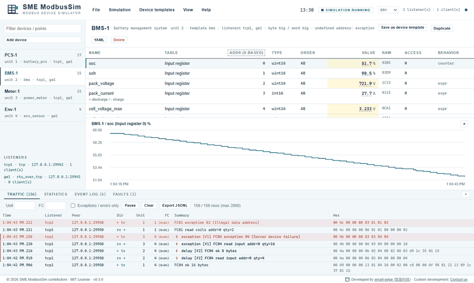

# SME ModbusSim

A Modbus TCP / RTU device simulator with a live web UI. Simulate battery PCS, BMS, power meters, environment
sensors — or any register map you describe in YAML — and watch the values change in the browser while a real
Modbus master (your EMS, a gateway, modpoll, pymodbus…) reads and writes them.

- **Many devices, one port.** One listener serves many unit IDs; a device can be attached to several listeners.
  Modbus TCP, Modbus UDP, Modbus/TCP Security (TLS), Modbus RTU over TCP and serial RTU are supported side by side.
- **Own protocol core.** Function codes 01, 02, 03, 04, 05, 06, 0F, 10, 16, 17 and 2B/0E (hex) with standard exception responses; serial listeners also answer the diagnostic function codes 07, 08, 0B, 0C and 11.
- **All the data types**, with byte order, word order, scale and offset.
- **Realistic behavior.** Sine, random walk, expressions, ramp / follow, counters, pulses and CSV replay;
  generic templates for battery PCS, BMS, power meter and environment sensor.
- **Live UI** in English, Japanese and Simplified Chinese, plus a REST / WebSocket API.

SME ModbusSim is free and MIT-licensed, developed by [smart-edge (智届科技)](https://smartedge-tech.com) —
custom development is available, see [Commercial support & custom development](commercial-support.md).

Also included: [fault injection](faults.md), [Excel point lists](excel.md), user-local templates and SunSpec PV inverter /
meter / DER / battery templates ([templates](behaviors-templates.md)), and [device management](device-management.md) in the UI, and read-only scan / record of real devices ([quick start](quick-start.md)).
Not affiliated with, endorsed by, or certified by SunSpec Alliance; the SunSpec templates are generated from the public
SunSpec model definitions (Apache-2.0).

Released in 0.2.0: serial Modbus ASCII; built-in pty pair for serial testing without drivers (Linux / macOS / WSL2); serial diagnostic function codes 07 / 08 / 0B / 0C / 11.

Released in 0.3.0: Modbus UDP listener; Modbus/TCP Security (TLS) listener with client certificates and role-based authorization; UDP and TLS for the read-only scan / record client.
