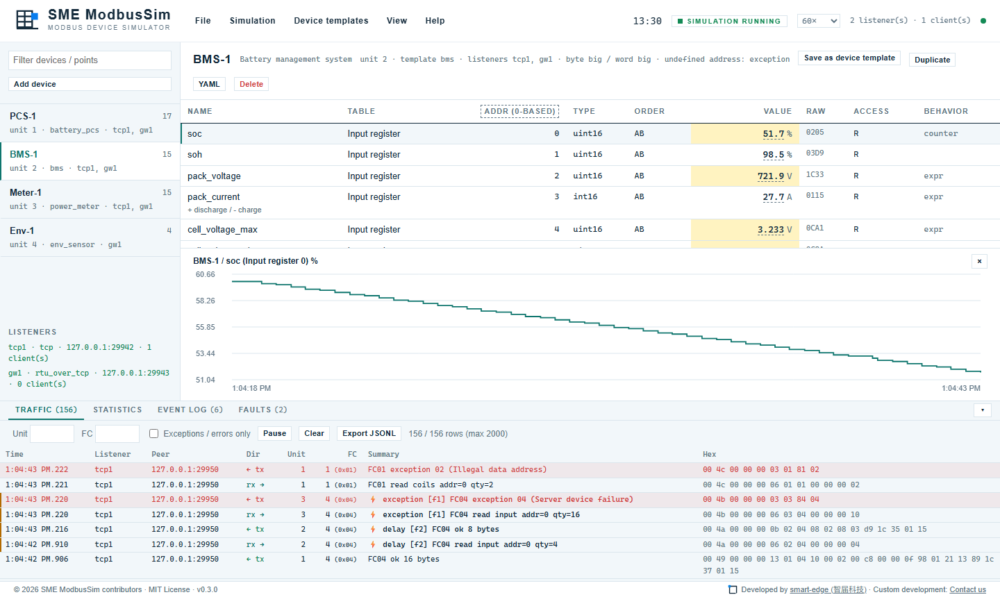
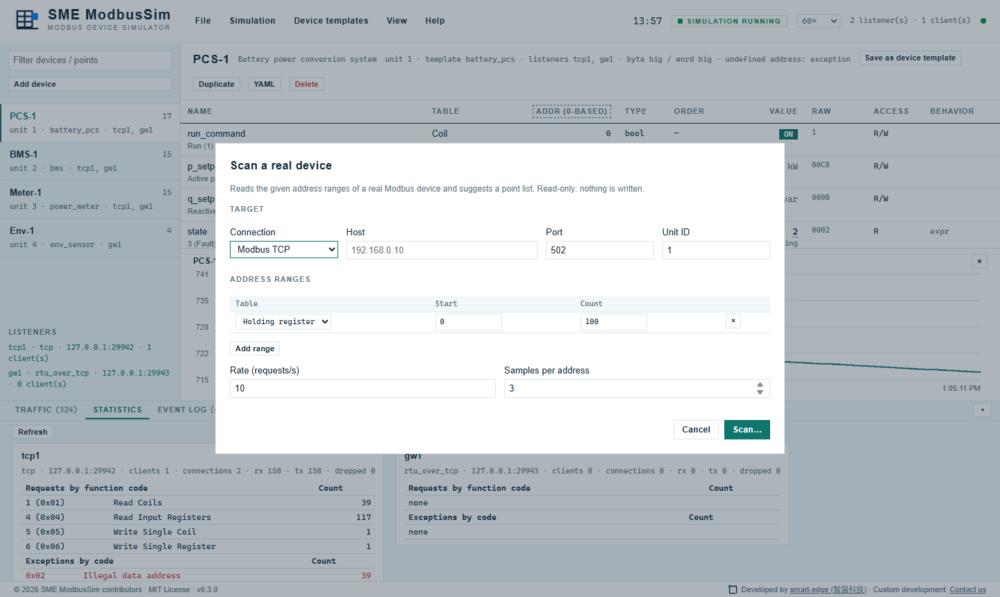

# Quick start

## Windows exe



Download `sme-modbus-sim-<version>-windows.exe` from the
[Releases](https://github.com/smartedge-tech-dev/sme-modbus-sim/releases/latest) page and run it. The browser opens
the UI at <http://127.0.0.1:8081/>.

## Docker

```bash
docker run --rm -p 8081:8081 -p 5020:5020 -p 5021:5021 ghcr.io/smartedge-tech-dev/sme-modbus-sim
```

Images exist for `linux/amd64`, `linux/arm64` and `linux/arm/v7`. Set `-e TZ=Asia/Tokyo` for a local clock
(default UTC). Mount your own config with `-v ./my.yaml:/app/configs/my.yaml` and append
`python -m sme_modbus_sim run -c configs/my.yaml --host 0.0.0.0 --no-browser`. The container runs as a non-root
user, so listen on ports of 1024 or above (5020, not 502).

## Serial RTU and RTU over TCP

Serial RTU defaults to 19200 baud, 8E1 (`type: rtu`, `port: COM5` or `/dev/ttyUSB0`). RTU over TCP serves RTU frames on a TCP port, for serial gateways and masters in RTU-over-TCP mode. Serial ASCII (`type: ascii`) defaults to 19200 baud, 7E1, and drops an unfinished frame after 1 s without characters (`char_timeout`).

```yaml
listeners:
  - {id: com1, type: rtu, port: COM5, baudrate: 19200, parity: E}   # serial RTU, 8E1
  - {id: gw1, type: rtu_over_tcp, host: 0.0.0.0, port: 5021}        # RTU over TCP
```

Pass the serial adapter into the container with `--device` (Linux hosts; the container runs as a non-root user, so add the device group):

```bash
docker run --rm --device /dev/ttyUSB0 --group-add dialout -p 8081:8081 \
  -v ./serial.yaml:/app/configs/serial.yaml ghcr.io/smartedge-tech-dev/sme-modbus-sim \
  python -m sme_modbus_sim run -c configs/serial.yaml --host 0.0.0.0 --no-browser
```

Masters: `modpoll -m rtu -b 19200 -d 8 -p even -a 1 -0 -r 0 -c 4 -t 4 COM6` (the other end of the serial link) and `modpoll -m enc -p 5021 -a 4 -0 -r 0 -c 2 -t 3 127.0.0.1` (RTU over TCP).

One Windows PC: Windows has no built-in virtual COM port pair. Options: [SerialLoom](https://github.com/RahulP5/SerialLoom) (free, MIT; builds on the Microsoft-signed usbip-win2 host controller, so the COM ports come from Windows' own usbser driver), a signed commercial virtual serial port driver, or two USB-RS485 adapters wired to each other (A-A, B-B). Windows' usbser driver starts the inter-byte timeout (`ReadIntervalTimeout`) before the first byte arrives, so a master that sets pyserial's `inter_byte_timeout` (modbus_tk does by default) reads 0 bytes whenever a reply takes longer than about one system timer tick (~16 ms); set it to `None` on the master side when testing over SerialLoom ([SerialLoom#16](https://github.com/RahulP5/SerialLoom/issues/16), [known limitations](https://github.com/RahulP5/SerialLoom/blob/main/docs/USB_PORTS.md#limitations)). Since SerialLoom 0.4.0, DTR reaches the other end as DSR and DCD ([SerialLoom#17](https://github.com/RahulP5/SerialLoom/issues/17)); RTS is not passed (CTS stays on), nor is BREAK. Virtual pairs may not pass RTS / DTR and do not pace bytes at the baud rate; com0com 3.0's 64-bit driver is not production-signed and does not load with Secure Boot on. To test RTU framing without any driver, use an `rtu_over_tcp` listener. On Linux, macOS and WSL2, an `rtu` listener with `port: pty` (and optionally `link: /tmp/ttyV0`) creates the virtual pair itself, with no driver; `socat -d -d pty,raw,echo=0 pty,raw,echo=0` also works.

## From source

```bash
python -m venv .venv
.venv/bin/pip install -r requirements.txt        # Windows: .venv\Scripts\pip
.venv/bin/python -m sme_modbus_sim run -c configs/demo-site.yaml
```

Python 3.11 or newer. Options:

| Command / option | Meaning |
|---|---|
| `sme-modbus-sim [run]` | Start the simulator (`run` is the default) |
| `-c, --config FILE` | YAML config (defaults to `configs/demo-site.yaml`) |
| `--host 0.0.0.0` | Web UI bind address (default localhost only) |
| `--http-port 8081` | Web UI port |
| `--no-browser` | Do not open the browser |
| `validate [-c] CONFIG` | Check a config file, including behavior expressions, and exit (0 = valid, 2 = error) |
| `templates` | List the device templates |

## Connect a Modbus master

The demo config listens on Modbus TCP port 5020 (units 1-3) and RTU over TCP port 5021 (unit 4).

```bash
modpoll -m tcp -p 5020 -a 1 -0 -r 0 -c 4 -t 4 127.0.0.1
modpoll -m enc -p 5021 -a 4 -0 -r 0 -c 2 -t 3 127.0.0.1
```

```python
from pymodbus.client import ModbusTcpClient

client = ModbusTcpClient("127.0.0.1", port=5020)
client.connect()
print(client.read_holding_registers(0, count=2, device_id=1).registers)
client.close()
```

Addresses in the configuration are 0-based protocol addresses; modpoll counts from 1 unless `-0` is given.

## Scan and record a real device

Both commands are **read-only** (only FC 01/02/03/04 and 2B/0E are sent), rate-limited (`--rate`, default 10
requests/s) and print a summary with the estimated request count before asking `Proceed? [y/N]`
(`-y` skips the question; without a terminal and without `-y` they abort).



```bash
# discover readable addresses and guess datatypes -> user template (guesses as YAML comments)
sme-modbus-sim scan --host 192.168.1.50 --unit 1 --range holding:0-199 --range input:0-99 --name meter1 -o meter1.yaml
# serial RTU: --serial COM5 --baudrate 9600 --parity N; RTU over TCP: --transport rtu_over_tcp; Modbus UDP: --transport udp; Modbus/TCP Security: --transport tls [--ca ca.crt --cert client.crt --key client.key]

# poll the points of a template (or -c site.yaml --device NAME) into a replay CSV
sme-modbus-sim record --host 192.168.1.50 --unit 1 --template meter1.yaml --period 1 --duration 600 -o meter1.csv
```

Datatypes are guesses: check them before use (copy the template into the user template directory to use it).
Failed reads leave an empty cell; replay holds the previous value for empty cells, but an empty cell in the
first data row is rejected, so fill it in before using the CSV. The web UI offers the same through
`/api/scan/*` and `/api/record/*` (one job at a time).

After a recording finishes, **Attach replay to points…** in the job dialog gives every recorded column's point a
`replay` behavior on the CSV (`{type: replay, file: <csv>, column: <point>, loop: true}`; loop is optional). It
targets the recorded device, or a device you pick when you recorded from a template; the dialog lists the
behaviors it replaces. A CSV whose first row has empty cells is refused. Like other device edits this changes the
running configuration; use Save to write it to the file (`POST /api/scan/apply/replay`).
