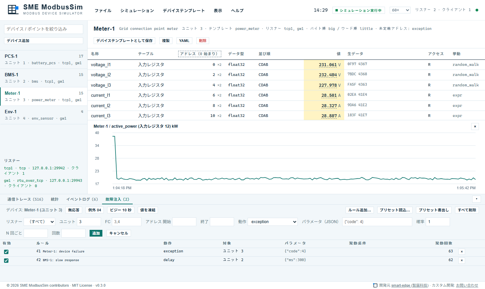

# 故障注入

故障ルールでシミュレータを意図的に異常動作させ、Modbus マスタ（EMS・ゲートウェイ・SCADA）の
タイムアウト・例外・フレーム破損・値の停滞への対応を試験できます。ルールは**実行時の状態**で、
Web UI（下部ペインの **故障注入** タブ）または REST API で管理し、YAML 設定には含まれません。
設定の再読込では保持され、再起動では消えます。



## ルールの項目

| 項目 | 既定値 | 意味 |
|---|---|---|
| `id` | 自動採番（`f1`, `f2`, ...） | API とトレース表示で使うルール ID |
| `name` | - | 任意の名前 |
| `enabled` | `true` | |
| `listener` | すべて | リスナー ID |
| `unit` | すべて | 要求のユニット ID |
| `function_codes` | すべて | ファンクションコードのリスト（例 `[3, 4]`） |
| `address_start` / `address_end` | すべて | 両端を含む範囲。要求の `start..start+数量-1` と重なれば一致（FC 23 は読み・書きどちらかの範囲） |
| `action` | - | 下表 |
| `params` | `{}` | 動作パラメータ |
| `probability` | `1` | 0〜1。一致した要求で発動する確率 |
| `every_n` | - | 一致した要求の N 回に 1 回だけ発動 |
| `remaining` | - | 指定回数発動した後、ルールは自動で無効になる |

ルールは要求ごとに一覧の順に評価され、**最初に発動したルールが適用**されます。条件には一致したが
`every_n` / `probability` で今回は発動しないルールは、次のルールに評価を譲ります。発動はトレース
イベントに記録され（`fault: {rule, action}`）、通信トレース画面では稲妻マーク付きで表示されます。

## 動作

| 動作 | パラメータ | 効果 |
|---|---|---|
| `exception` | `code`: 01〜06, 08, 0A, 0B（数値または16進文字列、既定 04） | その例外を返す。要求は実行しない |
| `delay` | `ms`、または `min_ms` + `max_ms`（ランダム） | 応答を遅らせる。他の接続には影響しない |
| `no_response` | - | 要求を捨てる（実行も応答もしない） |
| `disconnect` | - | TCP / RTU over TCP：要求受信後に接続を切断。シリアル RTU では `no_response` と同じ。UDP: 閉じる接続がなく、要求は無応答のまま |
| `corrupt_crc` | - | RTU / RTU over TCP / シリアル RTU：CRC 2 バイトを反転。シリアル ASCII：LRC を反転。Modbus TCP / UDP には適用しない |
| `truncate` | `bytes`（既定 3） | 応答フレームの先頭 N バイトだけ送る |
| `wrong_transaction_id` | - | Modbus TCP / UDP のみ：トランザクション ID + 1 で応答 |
| `wrong_unit_id` | `unit`（既定：要求のユニット + 1） | 別のユニット ID で応答 |
| `busy` | `seconds`（既定 10） | 初回発動から指定秒数、例外 06 を返し、その後ルールを無効にする |
| `freeze` | - | 一致したユニット（`unit` / `listener` 条件）の値をビヘイビアで更新しない。Modbus 応答と書込みは継続 |
| `refuse_connections` | - | リスナー単位（`listener` 条件）：新しい TCP 接続を即座に閉じる。`udp` リスナーでは、ルールが有効な間はすべてのデータグラムを破棄する（トレースのエラー "datagram refused (fault)"） |

## Web UI

**故障注入** タブにはルール一覧（有効スイッチ・発動回数・削除ボタン）が表示されます。クイック
ボタンはサイドバーで選択中のデバイスに作用します：**無応答**（`no_response`）、**例外 04**、
**ビジー 10 秒**、**値を凍結**。**ルール追加…** で任意のルールを作成でき、**プリセット読込…** /
**プリセット書出し** で JSON ファイルを読み書きします。

## プリセット

プリセットはルールの YAML / JSON リスト（または `faults:` リストを持つマッピング）です。設定ファイル
とは別のファイルとして保存してください（例 `faults/meter-flaky.yaml`）：

```yaml
- {id: slow, action: delay, params: {min_ms: 200, max_ms: 1500}, unit: 3, probability: 0.3}
- {id: crc, action: corrupt_crc, listener: gw1, every_n: 10}
- {action: exception, params: {code: "02"}, function_codes: [16], address_start: 100, address_end: 199}
```

CI スクリプトからの読み込み：

```bash
curl -X POST --data-binary @faults/meter-flaky.yaml http://127.0.0.1:8081/api/faults/preset
# ... シミュレータに対して試験を実行 ...
curl -X POST http://127.0.0.1:8081/api/faults/clear
```

`POST /api/faults/preset` は全ルールを置き換えます（追加は `?replace=false`）。1 件でも不正なら
何も変更しません。`GET /api/faults/export` は現在のルールを `faults.json` として返し、そのまま
再読込できます。[HTTP API](http-api.md) も参照してください。
