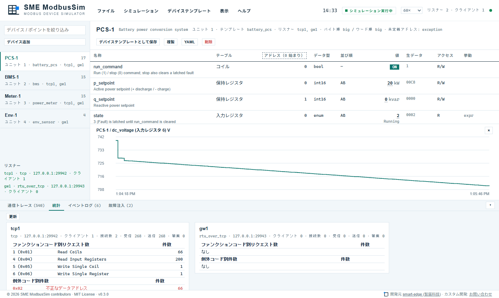

# HTTP API

Web UI はこの API を利用しており、スクリプトからも呼び出せます。すべてのルートは UI のポート（既定 8081）で提供されます。

| メソッド | パス | 内容 |
|---|---|---|
| GET | `/api/state` | シミュレーション、リスナー、デバイス、ポイント値のスナップショット |
| GET | `/api/templates` | 利用可能なデバイステンプレートとパラメーター |
| GET | `/api/history/{device}/{point}` | ポイントの直近のサンプル |
| POST | `/api/devices/{device}/points/{point}/write` | ポイントへ書き込み。ボディは `{"value": 12.5}` |
| POST | `/api/simulation` | 一時停止 / 再開と時間倍率: `{"running": true, "time_scale": 10}` |
| GET | `/api/config` | 現在の設定を YAML で取得 |
| PUT | `/api/config` | 設定を置き換え（ボディは YAML）。不正な場合は理由付きで拒否されます |
| POST | `/api/config/save` | 現在の設定を設定ファイルへ書き戻し |
| GET | `/api/trace` | 直近の Modbus 要求 / 応答。クエリ: `limit`, `unit`, `fc`, `listener` |
| GET | `/api/stats` | 要求カウンター |
| GET | `/api/version` | シミュレーターのバージョン |
| WS | `/ws` | 値の変化、通信ログ、イベントのライブストリーム |

```bash
curl -X POST http://127.0.0.1:8081/api/devices/PCS-1/points/p_setpoint/write \
     -H "Content-Type: application/json" -d '{"value": 20}'
```


## Excel とユーザーテンプレート

| メソッド | パス | 説明 |
|---|---|---|
| `GET` | `/api/config/xlsx` | 実行中の設定を `.xlsx` で取得 |
| `GET` | `/api/config/xlsx-template` | 空のブック |
| `POST` | `/api/config/import` | ブックをインポート（マルチパート `file`）。エラー時 `400` とエラー一覧 |
| `POST` | `/api/templates/reload` | ユーザーテンプレートディレクトリを再読込。`loaded` とファイルごとの `errors` を返す |
| `POST` | `/api/templates/from-device/{device}` | デバイスの展開済みポイントをユーザーテンプレートとして保存（`{"name", "overwrite"}`）。既存なら `409` |

## 故障注入

| メソッド | パス | 説明 |
|---|---|---|
| `GET` | `/api/faults` | ルール一覧 `{"rules": [...]}`（`triggers`・`matches`・`active` 付き） |
| `POST` | `/api/faults` | ルールを作成（JSON）。`id` 付きで返す |
| `PUT` | `/api/faults/{id}` | ルールを更新。省略した項目は元の値のまま |
| `DELETE` | `/api/faults/{id}` | ルールを削除 |
| `POST` | `/api/faults/clear` | 全ルールを削除 |
| `POST` | `/api/faults/preset` | YAML / JSON プリセット（本文）を読み込み、全ルールを置換。`?replace=false` で追加 |
| `GET` | `/api/faults/export` | ルールを `faults.json` で返す |

変更は `/ws` に `{"type": "faults", "rules": [...]}` として配信されます。[故障注入](faults.md) を参照。

## デバイス管理

| メソッド | パス | 説明 |
|---|---|---|
| `POST` | `/api/devices` | デバイスを追加（JSON：`name`、`unit_id`、任意で `listeners`、`template`、`params`、`points` など） |
| `POST` | `/api/devices/{name}/duplicate` | デバイスを複製。任意の JSON `{"name", "unit_id"}`。省略時は `{name}_copy` と、同じリスナー上の次の空きユニット ID |
| `DELETE` | `/api/devices/{name}` | デバイスを削除 |
| `GET` | `/api/devices/{name}/config` | そのデバイスの設定（YAML） |
| `PUT` | `/api/devices/{name}/config` | 本文の YAML でそのデバイスを置き換え（名前の変更も可） |

変更はすべて検証のうえ、`PUT /api/config` と同じ再読込で反映されます。実行中の設定はモデルから書き直されます
（指定したキーのみ残り、YAML のコメントは失われます）。ファイルへの保存は `POST /api/config/save` です。
エラー：`404` 不明なデバイス、`409` 名前の重複、`400` 検証エラー（pydantic のエラーを `field: message` で列挙）。
[デバイス管理](device-management.md) を参照してください。

## 統計のプッシュ

クライアントが 1 つ以上接続している間、`/ws` はリスナーごとのカウンタを 2 秒ごとに送信します。



```json
{"type": "stats", "t": 1764052800.0, "stats": {"tcp1": {"type": "tcp", "requests": {"3": 120}, "exceptions": {}, "clients": 1}}}
```

`stats` の形式は `GET /api/stats` と同じです。
