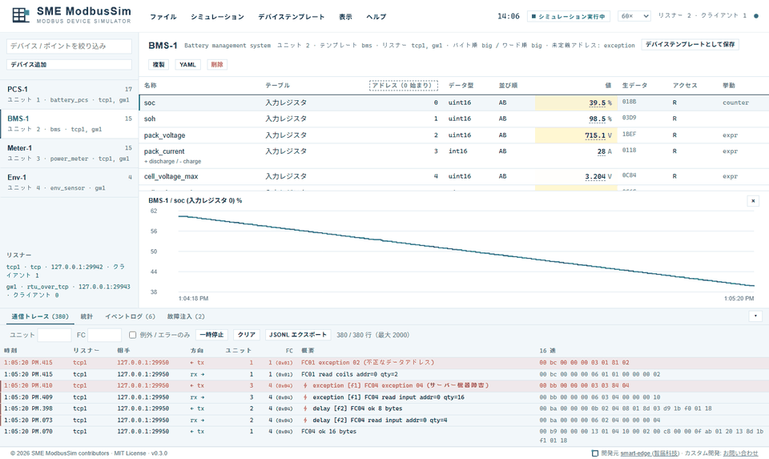

# SME ModbusSim

ライブ Web UI 付きの、無料・オープンソース（MIT）の Modbus TCP / RTU スレーブ（サーバー）シミュレーターです。
Windows / Linux / Docker で動作します。蓄電池 PCS、BMS、電力量計、環境センサー、
あるいは YAML で記述した任意のレジスタマップを模擬し、実際の Modbus マスター（EMS、ゲートウェイ、modpoll、
pymodbus など）が読み書きする様子を、値の変化とともにブラウザで確認できます。

- **1 つのポートで複数デバイス。** 1 つのリスナーが複数のユニット ID を受け持ち、1 台のデバイスを複数のリスナーに
  接続することもできます。Modbus TCP、Modbus UDP、Modbus/TCP Security（TLS）、Modbus RTU over TCP、シリアル RTU を同時に利用できます。
- **独自のプロトコルコア。** ファンクションコード 01 / 02 / 03 / 04 / 05 / 06 / 0F / 10 / 16 / 17 / 2B-0E（16 進）に対応し、
  標準の例外レスポンスを返します。シリアルリスナーは診断ファンクションコード 07 / 08 / 0B / 0C / 11 にも応答します。
- **豊富なデータ型。** バイトオーダー、ワードオーダー、スケール、オフセットを指定できます。
- **リアルな挙動。** 正弦波、ランダムウォーク、式、ランプ / 追従、カウンター、パルス、CSV リプレイ。
  蓄電池 PCS、BMS、電力量計、環境センサーの汎用テンプレートを備えます。
- **ライブ UI**（英語・日本語・簡体字中国語）と REST / WebSocket API。

SME ModbusSim は無料の MIT ライセンスで、[smart-edge（智届科技）](https://smartedge-tech.com) が開発しています。
カスタム開発も承ります。[商用サポート・カスタム開発](commercial-support.md) をご覧ください。

あわせて、[障害注入](faults.md)、[Excel ポイント一覧](excel.md)、ユーザーローカルテンプレートと SunSpec PV インバーター /
電力量計 / DER / 蓄電池テンプレート（[テンプレート](behaviors-templates.md)）、UI の[デバイス管理](device-management.md)、実機の読み取り専用スキャン / 記録（[クイックスタート](quick-start.md)）を備えます。
SunSpec Alliance とは提携・推奨・認証の関係にありません。SunSpec テンプレートは公開されている SunSpec モデル定義
（Apache-2.0）から生成しています。

0.2.0 でリリース済み: シリアル Modbus ASCII、ドライバー不要のシリアル試験用 pty ペア内蔵（Linux / macOS / WSL2）、シリアル診断ファンクションコード 07 / 08 / 0B / 0C / 11。

0.3.0 でリリース済み: Modbus UDP リスナー、クライアント証明書とロールベース認可に対応した Modbus/TCP Security（TLS）リスナー、読み取り専用 scan / record クライアントの UDP / TLS 対応。

## 主な用途

- **実機なしで Modbus マスターを試験。** EMS、SCADA、PLC、ゲートウェイの接続先を、実機のスレーブから
  シミュレーターに切り替えるだけです。
- **現場を手元で再現。** [Excel ポイントリスト](excel.md) を取り込むか、
  [蓄電池 PCS・BMS・電力量計・SunSpec のテンプレート](behaviors-templates.md) から始めるか、実機を scan / record
  します（[クイックスタート](quick-start.md)）。
- **異常系の試験。** タイムアウト、例外応答などを [障害注入](faults.md) で再現できます。

## smart-edge のシミュレータシリーズ

SME ModbusSim は、smart-edge が公開している無料・MIT ライセンスのプロトコルシミュレータシリーズの 1 つです。
Web UI と操作体系は共通なので、1 つ覚えれば他のシミュレータも同じ感覚で使えます。

| シミュレータ | 対象 | ドキュメント |
|---|---|---|
| [SME BACnetSim](https://github.com/smartedge-tech-dev/sme-bacnet-sim) | BACnet/IP デバイスシミュレータ | [ドキュメント](https://smartedge-tech-dev.github.io/sme-bacnet-sim/ja/) |
| **SME ModbusSim**（本プロジェクト） | Modbus TCP / RTU / UDP / TLS スレーブ（サーバー）シミュレーター | [ドキュメント](https://smartedge-tech-dev.github.io/sme-modbus-sim/ja/) |
| [SME OCPPSim](https://github.com/smartedge-tech-dev/sme-ocpp-sim) | OCPP 1.6J / 2.0.1 充電器シミュレーター | [ドキュメント](https://smartedge-tech-dev.github.io/sme-ocpp-sim/ja/) |

smart-edge のオープンソースツール一覧: <https://smartedge-tech.com/open-source/>
