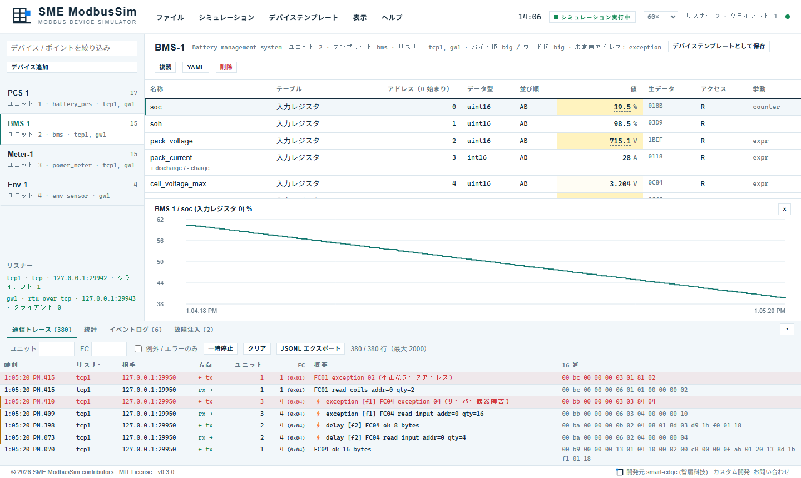
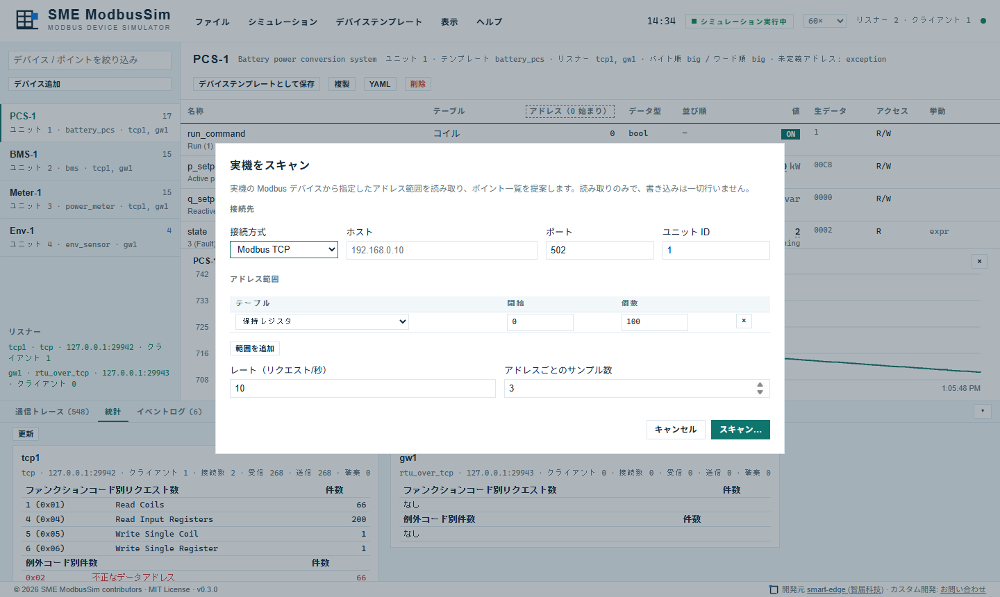

# クイックスタート

## Windows exe



[Releases](https://github.com/smartedge-tech-dev/sme-modbus-sim/releases/latest) から
`sme-modbus-sim-<version>-windows.exe` をダウンロードして実行します。ブラウザで <http://127.0.0.1:8081/> が開きます。

## Docker

```bash
docker run --rm -p 8081:8081 -p 5020:5020 -p 5021:5021 ghcr.io/smartedge-tech-dev/sme-modbus-sim
```

イメージは `linux/amd64`、`linux/arm64`、`linux/arm/v7` 向けです。ローカル時刻を使うには `-e TZ=Asia/Tokyo` を指定します
（既定は UTC）。独自の設定は `-v ./my.yaml:/app/configs/my.yaml` でマウントし、
`python -m sme_modbus_sim run -c configs/my.yaml --host 0.0.0.0 --no-browser` を末尾に付けて起動します。
コンテナーは root 以外のユーザーで動作するため、待ち受けポートは 1024 以上（502 ではなく 5020）にしてください。

## シリアル RTU と RTU over TCP

シリアル RTU は既定で 19200 baud、8E1 です（`type: rtu`、`port: COM5` または `/dev/ttyUSB0`）。RTU over TCP は RTU フレームを TCP ポートで提供し、シリアルゲートウェイや RTU over TCP モードのマスター向けです。シリアル ASCII（`type: ascii`）は既定で 19200 baud、7E1 で、1 s 文字が届かなければ未完のフレームを破棄します（`char_timeout`）。

```yaml
listeners:
  - {id: com1, type: rtu, port: COM5, baudrate: 19200, parity: E}   # serial RTU, 8E1
  - {id: gw1, type: rtu_over_tcp, host: 0.0.0.0, port: 5021}        # RTU over TCP
```

Docker ではシリアルアダプターを `--device` でコンテナーに渡します（Linux ホスト。コンテナーは root 以外で動作するため、デバイスのグループを追加します）:

```bash
docker run --rm --device /dev/ttyUSB0 --group-add dialout -p 8081:8081 \
  -v ./serial.yaml:/app/configs/serial.yaml ghcr.io/smartedge-tech-dev/sme-modbus-sim \
  python -m sme_modbus_sim run -c configs/serial.yaml --host 0.0.0.0 --no-browser
```

マスター側: `modpoll -m rtu -b 19200 -d 8 -p even -a 1 -0 -r 0 -c 4 -t 4 COM6`（シリアル接続の相手側）、RTU over TCP は `modpoll -m enc -p 5021 -a 4 -0 -r 0 -c 2 -t 3 127.0.0.1`。

1 台の Windows PC で試す場合: Windows には仮想 COM ポートのペアが標準で用意されていません。選択肢: [SerialLoom](https://github.com/RahulP5/SerialLoom)（無料、MIT。Microsoft 署名済みの usbip-win2 ホストコントローラーを使い、COM ポートは Windows 標準の usbser ドライバーが作ります）、署名済みの市販仮想シリアルポートドライバー、USB-RS485 アダプター 2 本の相互配線（A-A、B-B）。Windows 標準の usbser ドライバーは最初のバイトが届く前からバイト間タイムアウト（`ReadIntervalTimeout`）を数え始めるため、pyserial の `inter_byte_timeout` を設定するマスター（modbus_tk は既定で設定）は、応答がシステムタイマー約 1 周期（約 16 ms）より遅れると 0 バイトを読みます。SerialLoom で試験するときはマスター側で `None` にしてください（[SerialLoom#16](https://github.com/RahulP5/SerialLoom/issues/16)、[上流の既知の制限](https://github.com/RahulP5/SerialLoom/blob/main/docs/USB_PORTS.md#limitations)）。SerialLoom 0.4.0 以降、一方の DTR は相手側の DSR と DCD として伝わります（[SerialLoom#17](https://github.com/RahulP5/SerialLoom/issues/17)）。RTS は伝わらず（CTS は常にオン）、BREAK も伝わりません。仮想ペアは RTS / DTR を伝えないことがあり、ボーレートどおりの速度にもなりません。com0com 3.0 の 64 ビットドライバーは正式署名されておらず、セキュアブート有効時には読み込まれません。ドライバーなしで RTU フレームを試すなら `rtu_over_tcp` リスナーを使えます。Linux、macOS、WSL2 では、`rtu` リスナーに `port: pty`（必要なら `link: /tmp/ttyV0` も）を指定すると、ModbusSim 自身が仮想ペアを作成します（ドライバ不要）。`socat -d -d pty,raw,echo=0 pty,raw,echo=0` も使えます。

## ソースから実行

```bash
python -m venv .venv
.venv/bin/pip install -r requirements.txt        # Windows: .venv\Scripts\pip
.venv/bin/python -m sme_modbus_sim run -c configs/demo-site.yaml
```

Python 3.11 以上が必要です。オプション:

| コマンド / オプション | 内容 |
|---|---|
| `sme-modbus-sim [run]` | シミュレーターを起動します（`run` は省略可） |
| `-c, --config FILE` | YAML 設定ファイル（既定: `configs/demo-site.yaml`） |
| `--host 0.0.0.0` | Web UI のバインドアドレス（既定はローカルホストのみ） |
| `--http-port 8081` | Web UI のポート |
| `--no-browser` | ブラウザを開きません |
| `validate [-c] CONFIG` | 設定ファイル（ビヘイビア式を含む）を検証して終了します（0 = 正常、2 = エラー） |
| `templates` | デバイステンプレートを一覧表示します |

## Modbus マスターから接続する

デモ設定は Modbus TCP ポート 5020（ユニット 1〜3）と RTU over TCP ポート 5021（ユニット 4）で待ち受けます。

```bash
modpoll -m tcp -p 5020 -a 1 -0 -r 0 -c 4 -t 4 127.0.0.1
modpoll -m enc -p 5021 -a 4 -0 -r 0 -c 2 -t 3 127.0.0.1
```

```python
from pymodbus.client import ModbusTcpClient

client = ModbusTcpClient("127.0.0.1", port=5020)
client.connect()
print(client.read_holding_registers(0, count=2, device_id=1).registers)
client.close()
```

設定ファイルのアドレスは 0 始まりのプロトコルアドレスです。modpoll は `-0` を付けない限り 1 始まりで数えます。

## 実機のスキャンと記録

どちらのコマンドも **読み取り専用**（FC 01/02/03/04 と 2B/0E のみ送信）で、送信レートを制限し（`--rate`、既定
10 リクエスト/秒）、推定リクエスト数を含む概要を表示してから `Proceed? [y/N]` で確認します
（`-y` で確認を省略。端末がなく `-y` もない場合は中止します）。



```bash
# 読み取り可能なアドレスを探索してデータ型を推定 -> ユーザーテンプレート（推定は YAML コメント）
sme-modbus-sim scan --host 192.168.1.50 --unit 1 --range holding:0-199 --range input:0-99 --name meter1 -o meter1.yaml
# シリアル RTU: --serial COM5 --baudrate 9600 --parity N、RTU over TCP: --transport rtu_over_tcp、Modbus UDP: --transport udp、Modbus/TCP Security: --transport tls [--ca ca.crt --cert client.crt --key client.key]

# テンプレート（または -c site.yaml --device NAME）のポイントを周期読み出しして replay 用 CSV に記録
sme-modbus-sim record --host 192.168.1.50 --unit 1 --template meter1.yaml --period 1 --duration 600 -o meter1.csv
```

データ型は推定です。使う前に確認してください（使うにはテンプレートをユーザーテンプレートディレクトリへコピー）。
読み取りに失敗したセルは空になります。replay は空セルで直前の値を保持しますが、最初のデータ行の空セルは
エラーになるため、CSV を使う前に埋めてください。Web UI からは `/api/scan/*` と `/api/record/*`
（同時に 1 ジョブ）で同じ操作ができます。

記録が終わったら、ジョブダイアログの **ポイントに replay を設定…** で、記録した各列の同名ポイントに CSV の
`replay` ビヘイビア（`{type: replay, file: <csv>, column: <ポイント>, loop: true}`、loop は任意）を設定できます。
対象は記録元デバイス（テンプレートから記録した場合は選んだデバイス）で、置き換えられるビヘイビアはダイアログに
一覧表示されます。最初の行に空セルがある CSV は拒否されます。ほかのデバイス編集と同じく実行中の設定を変更する
だけなので、ファイルへは「保存」で書き込んでください（`POST /api/scan/apply/replay`）。
