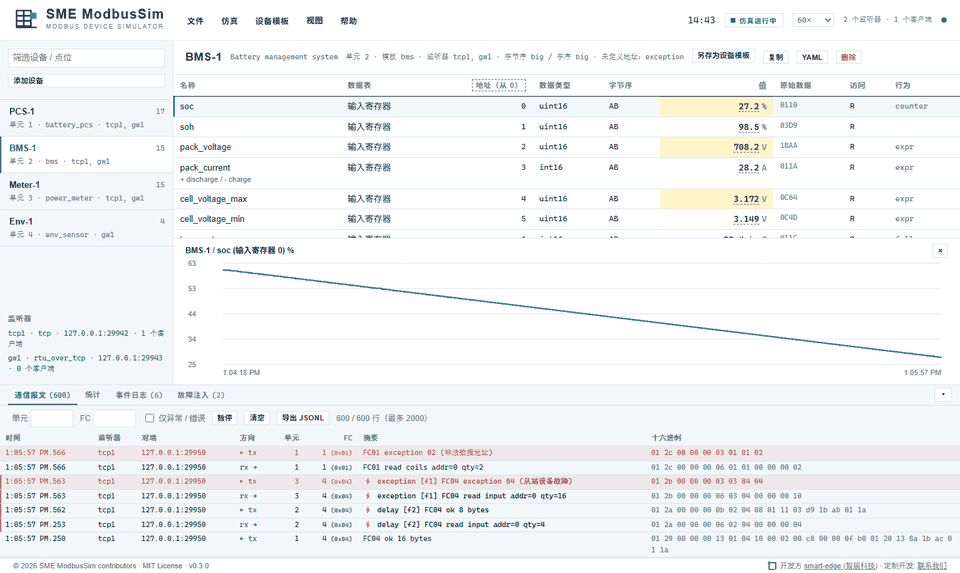

# SME ModbusSim

一个免费开源（MIT）、带实时 Web UI 的 Modbus TCP / RTU 从站（Slave / Server）模拟器（仿真软件），支持 Windows、Linux 和 Docker。可以模拟储能 PCS、BMS、电能表、环境传感器，或任何用 YAML 描述的
寄存器表，并在浏览器中观察数值变化，同时由真实的 Modbus 主站（你的 EMS、网关、modpoll、pymodbus……）读写这些设备。

- **一个端口承载多台设备。** 一个监听器可服务多个站号（unit ID），一台设备也可以挂在多个监听器上。
  Modbus TCP、Modbus UDP、Modbus/TCP Security（TLS）、Modbus RTU over TCP 与串口 RTU 可同时使用。
- **自研协议核心。** 支持功能码 01 / 02 / 03 / 04 / 05 / 06 / 0F / 10 / 16 / 17 / 2B-0E（十六进制），并返回标准异常响应；串口监听器另外支持诊断功能码 07 / 08 / 0B / 0C / 11。
- **数据类型齐全**，可配置字节序、字序、比例系数和偏移。
- **行为逼真。** 正弦、随机游走、表达式、斜率 / 一阶跟随、计数器、脉冲和 CSV 回放；
  提供储能 PCS、BMS、电能表和环境传感器的通用模板。
- **实时 UI**（英文、日文、简体中文）以及 REST / WebSocket API。

SME ModbusSim 免费且采用 MIT 许可，由 [smart-edge（智届科技）](https://smartedge-tech.com) 开发，也可承接定制开发，
详见[商务支持与定制开发](commercial-support.md)。

同时提供：[故障注入](faults.md)、[Excel 点表](excel.md)、用户本地模板与 SunSpec 光伏逆变器 / 电能表 / DER / 电池模板
（[模板](behaviors-templates.md)），UI 中的[设备管理](device-management.md)，以及真实设备的只读扫描 / 录制（[快速入门](quick-start.md)）。
与 SunSpec Alliance 无任何关联，未获其认可或认证；SunSpec 模板由公开的 SunSpec 模型定义（Apache-2.0）生成。

已在 0.2.0 中发布：串口 Modbus ASCII；内置 pty 虚拟串口对，免驱动做串口联调（Linux / macOS / WSL2）；串口诊断功能码 07 / 08 / 0B / 0C / 11。

已在 0.3.0 中发布：Modbus UDP 监听器；Modbus/TCP Security（TLS）监听器，支持客户端证书和按 role 授权；只读 scan / record 客户端支持 UDP 和 TLS。

## 典型用途

- **无需硬件即可测试 Modbus 主站。** 把 EMS、SCADA、PLC 或网关的连接目标从真实从站换成模拟器即可。
- **在桌面上复现现场。** 导入 [Excel 点表](excel.md)，从[储能 PCS、BMS、电表和 SunSpec 模板](behaviors-templates.md)开始，或对真实设备做 scan / record（[快速开始](quick-start.md)）。
- **测试异常处理。** 用[故障注入](faults.md)复现超时、异常响应等故障。

## smart-edge 模拟器系列

SME ModbusSim 是 smart-edge 免费、MIT 许可的协议模拟器系列之一。各模拟器共用同一套 Web UI 和操作方式，学会一个即可上手其他几个。

| 模拟器 | 模拟对象 | 文档 |
|---|---|---|
| [SME BACnetSim](https://github.com/smartedge-tech-dev/sme-bacnet-sim) | BACnet/IP 设备模拟器 | [文档](https://smartedge-tech-dev.github.io/sme-bacnet-sim/zh/) |
| **SME ModbusSim**（本项目） | Modbus TCP / RTU / UDP / TLS 从站（Slave）模拟器 | [文档](https://smartedge-tech-dev.github.io/sme-modbus-sim/zh/) |
| [SME OCPPSim](https://github.com/smartedge-tech-dev/sme-ocpp-sim) | OCPP 1.6J / 2.0.1 充电桩模拟器 | [文档](https://smartedge-tech-dev.github.io/sme-ocpp-sim/zh/) |

smart-edge 全部开源工具：<https://smartedge-tech.com/zh/open-source/>
