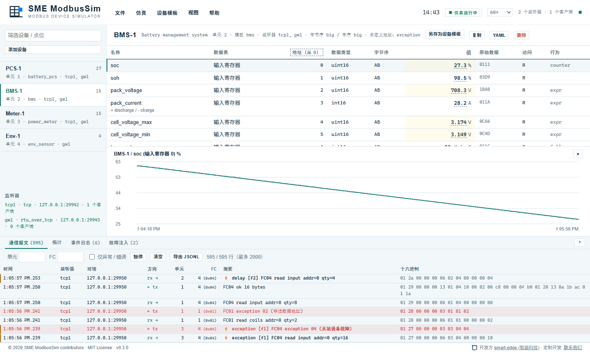
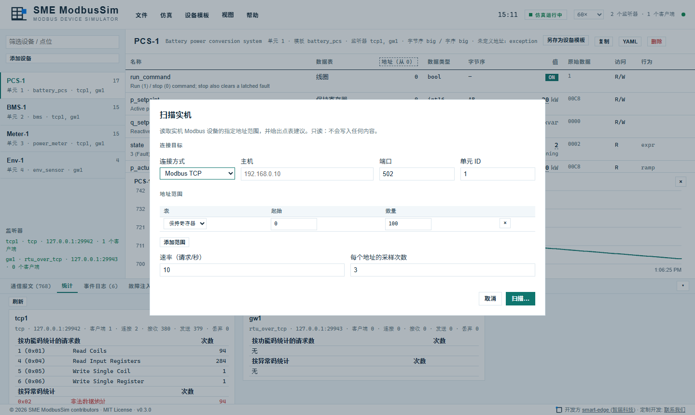

# 快速开始

## Windows exe



从 [Releases](https://github.com/smartedge-tech-dev/sme-modbus-sim/releases/latest) 下载
`sme-modbus-sim-<version>-windows.exe` 并运行，浏览器会打开 <http://127.0.0.1:8081/>。
不带 `-c` 启动时，exe 使用 `%USERPROFILE%\.sme-modbus-sim\config.yaml`（首次运行时由内置演示配置复制生成），
因此用 **文件 > 保存** 保存的修改在重启后仍然保留。

## Docker

```bash
docker run --rm -p 8081:8081 -p 5020:5020 -p 5021:5021 ghcr.io/smartedge-tech-dev/sme-modbus-sim
```

镜像提供 `linux/amd64`、`linux/arm64` 和 `linux/arm/v7`。使用本地时间请加 `-e TZ=Asia/Tokyo`（默认 UTC）。
使用自己的配置：用 `-v ./my.yaml:/app/configs/my.yaml` 挂载，并在命令末尾加上
`python -m sme_modbus_sim run -c configs/my.yaml --host 0.0.0.0 --no-browser`。
容器以非 root 用户运行，因此监听端口须不小于 1024（用 5020，而不是 502）。

## 串口 RTU 与 RTU over TCP

串口 RTU 默认 19200 波特率、8E1（`type: rtu`，`port: COM5` 或 `/dev/ttyUSB0`）。RTU over TCP 在 TCP 端口上提供 RTU 帧，适用于串口网关和 RTU over TCP 模式的主站。串口 ASCII（`type: ascii`）默认 19200 波特率、7E1，1 s 内没有新字符就丢弃未完成的帧（`char_timeout`）。

```yaml
listeners:
  - {id: com1, type: rtu, port: COM5, baudrate: 19200, parity: E}   # serial RTU, 8E1
  - {id: gw1, type: rtu_over_tcp, host: 0.0.0.0, port: 5021}        # RTU over TCP
```

Docker 中用 `--device` 把串口适配器传入容器（Linux 主机；容器以非 root 用户运行，需加入设备所属组）：

```bash
docker run --rm --device /dev/ttyUSB0 --group-add dialout -p 8081:8081 \
  -v ./serial.yaml:/app/configs/serial.yaml ghcr.io/smartedge-tech-dev/sme-modbus-sim \
  python -m sme_modbus_sim run -c configs/serial.yaml --host 0.0.0.0 --no-browser
```

主站示例：`modpoll -m rtu -b 19200 -d 8 -p even -a 1 -0 -r 0 -c 4 -t 4 COM6`（串口线另一端），RTU over TCP 用 `modpoll -m enc -p 5021 -a 4 -0 -r 0 -c 2 -t 3 127.0.0.1`。

在一台 Windows 电脑上联调：Windows 没有自带的虚拟 COM 口对。可选方案：[SerialLoom](https://github.com/RahulP5/SerialLoom)（免费，MIT；基于微软签名的 usbip-win2 主控制器，COM 口由 Windows 自带的 usbser 驱动生成）、已签名的商用虚拟串口驱动，或两个 USB-RS485 转换器互接（A-A、B-B）。Windows 自带的 usbser 驱动在第一个字节到达之前就开始计字节间超时（`ReadIntervalTimeout`），所以设置了 pyserial `inter_byte_timeout` 的主站（modbus_tk 默认会设）只要应答晚于约一个系统定时器周期（约 16 ms）就会读到 0 字节；用 SerialLoom 测试时请在主站端设为 `None`（[SerialLoom#16](https://github.com/RahulP5/SerialLoom/issues/16)，[上游已知限制](https://github.com/RahulP5/SerialLoom/blob/main/docs/USB_PORTS.md#limitations)）。SerialLoom 0.4.0 起，一端的 DTR 会作为对端的 DSR 和 DCD 传过去（[SerialLoom#17](https://github.com/RahulP5/SerialLoom/issues/17)）；RTS 不传（CTS 恒为 on），BREAK 也不传。虚拟串口对不一定传 RTS / DTR，也不按波特率限速；com0com 3.0 的 64 位驱动未经正式签名，开启 Secure Boot 时无法加载。只想测 RTU 帧、不装驱动，可以用 `rtu_over_tcp` 监听器。在 Linux、macOS 和 WSL2 上，给 `rtu` 监听器指定 `port: pty`（可再加 `link: /tmp/ttyV0`），ModbusSim 会自己创建虚拟串口对，不需要驱动；也可以用 `socat -d -d pty,raw,echo=0 pty,raw,echo=0`。

## 从源码运行

```bash
python -m venv .venv
.venv/bin/pip install -r requirements.txt        # Windows: .venv\Scripts\pip
.venv/bin/python -m sme_modbus_sim run -c configs/demo-site.yaml
```

需要 Python 3.11 或更高版本。选项：

| 命令 / 选项 | 含义 |
|---|---|
| `sme-modbus-sim [run]` | 启动模拟器（`run` 可省略） |
| `-c, --config FILE` | YAML 配置文件（默认 `configs/demo-site.yaml`；Windows exe 为 `~/.sme-modbus-sim/config.yaml`） |
| `--host 0.0.0.0` | Web UI 绑定地址（默认仅本机） |
| `--http-port 8081` | Web UI 端口 |
| `--no-browser` | 不自动打开浏览器 |
| `validate [-c] CONFIG` | 校验配置文件（含行为表达式）后退出（0 = 有效，2 = 错误） |
| `templates` | 列出设备模板 |

## 连接 Modbus 主站

演示配置在 Modbus TCP 端口 5020（站号 1-3）和 RTU over TCP 端口 5021（站号 4）上监听。

```bash
modpoll -m tcp -p 5020 -a 1 -0 -r 0 -c 4 -t 4 127.0.0.1
modpoll -m enc -p 5021 -a 4 -0 -r 0 -c 2 -t 3 127.0.0.1
```

```python
from pymodbus.client import ModbusTcpClient

client = ModbusTcpClient("127.0.0.1", port=5020)
client.connect()
print(client.read_holding_registers(0, count=2, device_id=1).registers)
client.close()
```

配置文件中的地址是从 0 开始的协议地址；modpoll 不加 `-0` 时从 1 开始计数。

## 扫描与录制实机

两个命令都是**只读**的（只发送 FC 01/02/03/04 与 2B/0E），带限速（`--rate`，默认每秒 10 个请求），
执行前会显示含预估请求数的概要并询问 `Proceed? [y/N]`（`-y` 跳过确认；没有终端又没有 `-y` 时直接中止）。



```bash
# 探测可读地址并推测数据类型 -> 用户模板（推测结果写成 YAML 注释）
sme-modbus-sim scan --host 192.168.1.50 --unit 1 --range holding:0-199 --range input:0-99 --name meter1 -o meter1.yaml
# 串口 RTU：--serial COM5 --baudrate 9600 --parity N；RTU over TCP：--transport rtu_over_tcp；Modbus UDP：--transport udp；Modbus/TCP Security：--transport tls [--ca ca.crt --cert client.crt --key client.key]

# 按周期读取模板（或 -c site.yaml --device NAME）中的点，写成 replay 用 CSV
sme-modbus-sim record --host 192.168.1.50 --unit 1 --template meter1.yaml --period 1 --duration 600 -o meter1.csv
```

数据类型只是推测，使用前请核对（把模板复制到用户模板目录即可使用）。读取失败的单元格留空；replay 对空单元格
沿用上一个值，但第一行数据中的空单元格会报错，使用 CSV 前请补上。Web UI 通过 `/api/scan/*` 与
`/api/record/*` 提供同样的功能（同一时间只允许一个作业）。

录制完成后，作业对话框里的 **给点挂上 replay…** 会给每个录制列的同名点挂上该 CSV 的 `replay` 行为
（`{type: replay, file: <csv>, column: <点名>, loop: true}`，loop 可选）。目标是录制所用的设备；若是从模板录制，
则需选择一个设备；对话框会列出将被替换的行为。第一行有空单元格的 CSV 会被拒绝。与其它设备编辑一样只改动运行中的
配置，要写入文件请用「保存」（`POST /api/scan/apply/replay`）。
